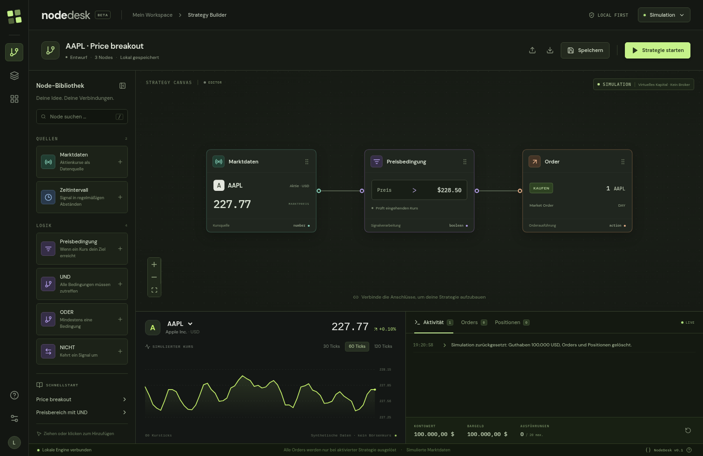

# NodeDesk

NodeDesk ist eine lokale Trading-App mit visuellem Strategy Builder. Verbinde Marktdaten, Bedingungen und Orders zu einem Ablauf, beobachte Kurse und Positionen und teste die Strategie mit einem virtuellen Konto. Optional verbindet sich der Node.js-Server über die Socket-API mit **IBKR TWS oder IB Gateway im Paper-Modus**.

Die App startet immer in der lokalen Simulation. Broker-Passwörter oder API-Schlüssel werden nicht in NodeDesk eingegeben. Die IBKR-Anmeldung erfolgt ausschließlich in TWS bzw. Gateway.



## Schnellstart

Voraussetzungen: **Node.js 22 oder neuer**, npm und ein aktueller Browser. Für die Simulation werden weder TWS noch ein IBKR-Konto benötigt.

```sh
git clone https://github.com/caxolotlfriends-a11y/twsnodetrading.git
cd twsnodetrading
npm ci
npm run dev
```

Öffne `http://127.0.0.1:3000` auf demselben Computer. Der Entwicklungsserver liefert Frontend und API gemeinsam aus; ein zweiter Server muss nicht gestartet werden. Beenden mit `Ctrl+C`.

Für die Verbindung mit deiner eigenen TWS führst du diese Schritte auf deinem Computer aus. Eine Cloud-Entwicklungsumgebung kann deine lokale TWS nicht über ihre eigene Adresse `127.0.0.1` erreichen. Die Simulation lässt sich unabhängig davon in der Cloud prüfen.

### Build und Prüfungen

```sh
npm test              # Engine-, Broker-Adapter- und API-Tests; keine echte TWS nötig
npm run typecheck     # TypeScript prüfen
npm run build         # Typprüfung und Frontend-Build nach dist/
npm start             # Build lokal ausliefern; vorher npm run build ausführen
```

Browser-Integrationstests (Chromium):

```sh
npx playwright install chromium  # entfällt bei vorhandenem /usr/bin/chromium
npm run test:e2e                 # startet bei Bedarf den Entwicklungsserver
```

Die Tests verwenden ausschließlich die Simulation und einen simulierten IB-Client. Sie senden keine Orders an eine echte TWS. Die Schriftarten werden lokal mitgeliefert; im Betrieb sind keine externen Font- oder Chartdienste nötig.

Auch `npm start` bindet ausschließlich an `127.0.0.1`. Der TypeScript-Server wird mit `tsx` ausgeführt; deshalb werden auch für diesen Start die Entwicklungsabhängigkeiten aus `npm ci` benötigt.

### Konfiguration

Optional lässt sich der HTTP-Port über `PORT` ändern, zum Beispiel unter macOS/Linux:

```sh
PORT=3100 npm run dev
```

Erlaubt sind Ports von 1024 bis 65535. Im Entwicklungsmodus verwendet HMR zusätzlich den Folgeport; wähle daher zwei freie Ports. `.env.example` dokumentiert den Standard. `.env`-Dateien werden aktuell **nicht automatisch geladen**; setze die Variable in deiner Shell oder deiner Prozesskonfiguration. TWS-Host, API-Port und Client-ID werden im Verbindungsdialog eingestellt.

## Eine Strategie bauen

1. Nutze die Vorlage **Price breakout** oder **Preisbereich mit UND**, oder füge Nodes per Klick bzw. Drag-and-drop aus der Bibliothek hinzu.
2. Verbinde einen rechten Ausgang mit dem linken Eingang der nächsten Node. Ein Klick auf eine Node öffnet ihre Einstellungen.
3. Wähle Symbol, Preisbedingung, Stückzahl und Ordertyp. Marktdaten und Order dürfen unterschiedliche Symbole verwenden; auch das Order-Zielsymbol benötigt einen aktuellen Kurs.
4. Klicke **Strategie starten**. Im Simulationsmodus werden Orders virtuell ausgeführt. Werte an den Nodes, Aktivitätsprotokoll, Orders und Positionen zeigen das Ergebnis.
5. Mit **Stoppen** beendest du die weitere Auswertung. Bereits gesendete oder noch offene Orders bleiben aktiv und müssen bei Bedarf einzeln storniert werden.

| Node | Eingang und Wirkung |
| --- | --- |
| Marktdaten | Quelle: aktueller Kurs eines Symbols |
| Preisbedingung | Genau ein Marktdaten-Eingang; vergleicht mit `>`, `≥`, `<` oder `≤` |
| UND | Mindestens zwei logische Eingänge; alle müssen wahr sein |
| ODER | Mindestens zwei logische Eingänge; mindestens einer muss wahr sein |
| NICHT | Genau ein logischer Eingang; kehrt das Signal um |
| Zeitintervall | Quelle: alle 2 bis 86.400 Sekunden ein kurzes Wahr-Signal |
| Order | Genau ein logischer Eingang; BUY oder SELL als Market- oder Limit-Order |

Die Oberfläche bietet **AAPL, MSFT, NVDA, TSLA, SPY und AMZN** als Vorschläge; im Symbolfeld einer Node lassen sich weitere US-Aktiensymbole eingeben. Die Paper-Anbindung verwendet Aktien/ETFs als `STK` über `SMART` mit Handelswährung USD; andere Instrumentklassen sind nicht umgesetzt. Für weitere Symbole müssen IBKR-Verfügbarkeit und Marktdatenberechtigung gegeben sein.

Ausführbare Graphs müssen kreisfrei sein und mindestens eine Order-Node enthalten. Die Validierung prüft Anschlüsse, Werte, eindeutige IDs und Grenzen von 60 Nodes bzw. 120 Verbindungen. Während einer Ausführung ist die Bearbeitung gesperrt.

### Speichern und übertragen

**Speichern** oder `Ctrl+S` / `⌘S` speichert die aktuelle Strategie im lokalen Browser-Speicher. Beim nächsten Öffnen desselben Browser-Ursprungs wird sie wieder geladen. Ein anderer Port oder Browser hat einen eigenen Speicher. Auch unvollständige Entwürfe lassen sich speichern. Die Ausführungsvalidierung erfolgt erst beim Start. Änderungen werden nicht automatisch gespeichert.

Über **Exportieren** erhältst du eine JSON-Datei; **Importieren** lädt und validiert eine solche Strategie. Exportiere wichtige Entwürfe als Sicherung. Kontostand, Positionen, Orders, Protokoll und die laufende Ausführung liegen nur im Server-Arbeitsspeicher und gehen bei dessen Neustart verloren. Die App verwaltet keine Benutzerkonten oder Datenbank.

## IBKR Paper Trading verbinden

Der Socket-Adapter ist implementiert und wird mit einem simulierten IB-API-Client getestet. Eine Verbindung und Orderausführung gegen eine tatsächlich laufende TWS bzw. einen IB Gateway wurde in der Cloud-Umgebung **nicht geprüft**.

1. Starte TWS oder IB Gateway auf deinem Computer und melde dich mit deinem **Paper-Konto** an. TWS kann alternativ auf einem erreichbaren Rechner im lokalen privaten Netz laufen.
2. Öffne in TWS **Globale Konfiguration → API → Einstellungen** und aktiviere **ActiveX- und Socket-Clients aktivieren**. Für Orderversand muss **Nur-Lese-API / Read-Only API** deaktiviert sein. Bezeichnungen können je nach TWS-Version abweichen.
3. Verwende den Paper-API-Port: **7497 für TWS**, **4002 für Gateway**. Für eine Verbindung aus dem lokalen Netz muss TWS diese Verbindung zulassen und die IP des NodeDesk-Rechners in den vertrauenswürdigen IPs stehen; auch die lokale Firewall muss den Socket-Zugriff erlauben.
4. Öffne in NodeDesk oben rechts den Verbindungsdialog, wähle **IBKR Paper** und trage Host, Port und eine freie Client-ID ein. Auf demselben Rechner ist der Host normalerweise `127.0.0.1`; für LAN-Verbindungen wird eine private IPv4-Adresse akzeptiert. Die Client-ID darf nicht bereits von einem anderen API-Client verwendet werden.
5. Klicke **Mit Paper-Konto verbinden**. NodeDesk wartet auf die bestätigte Kontoliste und eine gültige Order-ID. Alle gemeldeten Kontonummern müssen dem Format `DU` plus Ziffern entsprechen; andernfalls wird die Verbindung abgelehnt. Es wird das erste bestätigte Paper-Konto verwendet.
6. Prüfe Konto und Kurse. Erst **Paper-Orders freigeben** erlaubt den anschließenden Strategiestart. Nach Verbindung oder einem Brokerfehler ist die Freigabe ausgeschaltet und muss bewusst erneut erteilt werden.

NodeDesk fordert verzögerte Marktdaten an; IBKR kann bei vorhandener Berechtigung Echtzeitdaten liefern. Berechtigungen, Handelszeiten und TWS-Einstellungen bestimmen die tatsächlich verfügbaren Kurse. Fehlende oder seit mehr als 15 Sekunden nicht aktualisierte Kurse pausieren die Graph-Auswertung. Ohne frischen Kurs des Zielsymbols wird keine Order ausgelöst.

Paper-Orders werden als `DAY` und nur innerhalb regulärer Handelszeiten gesendet. Es werden keine Zugangsdaten an einen NodeDesk-Dienst übertragen. Die Verbindung läuft direkt vom lokalen Node.js-Prozess zum konfigurierten TWS-Socket. Der Server akzeptiert für diesen Socket nur Loopback bzw. private IPv4-Adressen und die beiden Paper-Ports. Die DU-Prüfung ergänzt die Portprüfung; ein Paper-Port allein bestätigt kein Paper-Konto.

### Wenn die Verbindung scheitert

- **Keine bestätigte Paper-Verbindung nach 10 Sekunden:** TWS-Anmeldung, API-Aktivierung, Host, Port, freie Client-ID, vertrauenswürdige IPs und Firewall prüfen.
- **Konto abgelehnt:** In TWS im Paper-Konto anmelden. Live-Ports 7496/4001 und Konten ohne bestätigtes DU-Format werden nicht akzeptiert.
- **Keine oder veraltete Kurse:** Marktdatenberechtigungen, verzögerte Daten und Handelszeiten prüfen. IBKR-Meldungen erscheinen im Aktivitätsprotokoll; Brokerfehler stoppen die Strategie und entziehen die Orderfreigabe.
- **Moduswechsel abgelehnt:** Zunächst offene Orders stornieren und den endgültigen Status abwarten. Nach einer Unterbrechung lässt sich derselbe Host/Port mit derselben Client-ID erneut verbinden. Offene Orders werden erneut abgeglichen. Nicht bestätigte Altorders erscheinen als `Unconfirmed` und sperren neue Paper-Orders; ihren Status in TWS prüfen.

## Ausführungsverhalten und Grenzen

- Pro Order sind **1 bis 1.000 ganze Aktien**, pro Strategiestart höchstens **20 Orders** erlaubt.
- Eine Order wird beim Wechsel ihres Signals von falsch auf wahr ausgelöst. Ein dauerhaft wahres Signal erzeugt nicht mit jedem Tick eine weitere Order. **Beim Neustart einer Strategie wird der Signalzustand zurückgesetzt**: Eine bereits wahre Bedingung kann sofort wieder eine Order auslösen. Zeitintervalle beginnen ebenfalls neu.
- **Stoppen, Freigabe entziehen oder die App beenden storniert keine bereits gesendeten Broker-Orders.** Nutze die Stornierung und prüfe den endgültigen Status; bei Problemen TWS verwenden. Auch eine offene simulierte Limit-Order kann nach dem Strategiestopp noch ausgeführt werden.
- Die Simulation beginnt mit **100.000 USD** und synthetischen, lokal erzeugten Kursen. Sie enthält keine Gebühren, Slippage, Teilausführungen, Margin oder Leerverkäufe und bildet keine historischen Kurse oder historische Performance ab. Market-Orders und ausführbare Limit-Orders werden zum aktuellen simulierten Kurs vollständig ausgeführt.
- Ein Zurücksetzen oder erneutes Aktivieren der Simulation verwirft deren bisherigen Kontostand, Orders und Positionen. Ein Serverneustart startet ebenfalls ein neues Simulationskonto.
- Aktienkurse, Limitpreise, Positionswerte und deren P/L werden in **USD** dargestellt. Cash und Kontowert des Paper-Kontos werden in der von IBKR gemeldeten **Kontobasiswährung** angezeigt, sobald die erforderlichen Kontowerte vollständig eingetroffen sind; bis dahin zeigt die Oberfläche einen Platzhalter. Es findet keine eigene Währungsumrechnung statt.

## Lokaler Betrieb und Projektaufbau

Die HTTP-App bindet an Loopback und prüft Host sowie bei Änderungen den Browser-Ursprung. Sie ist für einen einzelnen lokalen Nutzer ohne eigenes Login vorgesehen. Stelle sie nicht über einen öffentlichen Reverse-Proxy bereit. Echte Live-Konten und Live-Ports sind in dieser Version nicht unterstützt.

| Pfad | Inhalt |
| --- | --- |
| `src/` | React-Oberfläche und React-Flow-Editor |
| `shared/engine.ts` | Graph-Validierung und reine Strategieauswertung |
| `shared/types.ts` | Gemeinsame Datenstrukturen und Symbolliste |
| `server/trading-service.ts` | Simulation, Ausführung, Konto- und Orderzustand |
| `server/paper-broker.ts` | IBKR-Socket-Adapter mit Paper-Kontoprüfung |
| `server/app.ts` | Lokale JSON-API und Statusupdates über Server-Sent Events |
| `tests/` | Automatisierte Engine-, Service-, API- und Adaptertests |
